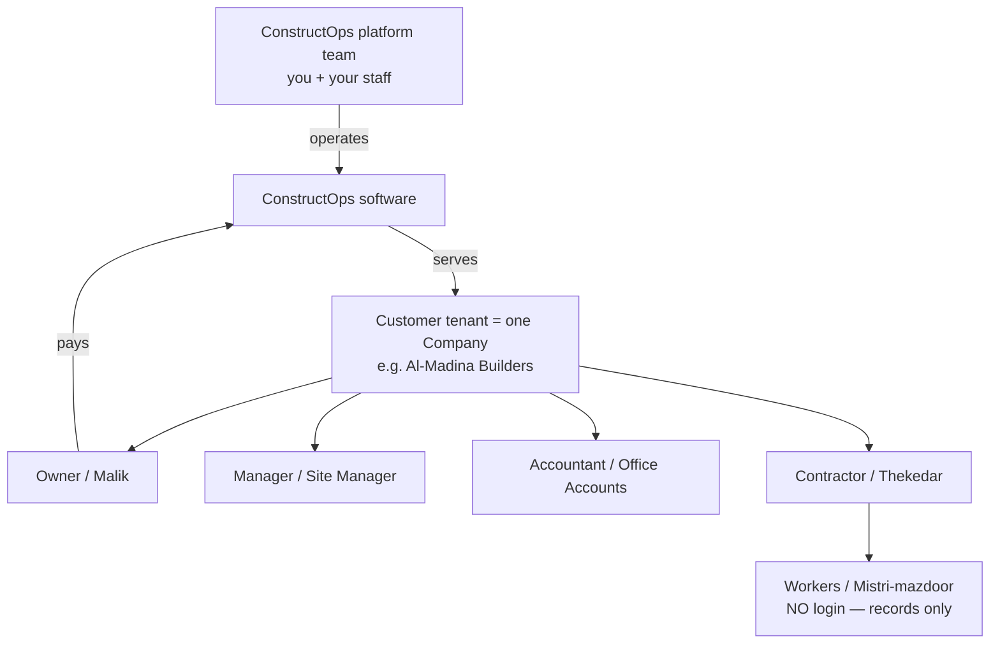
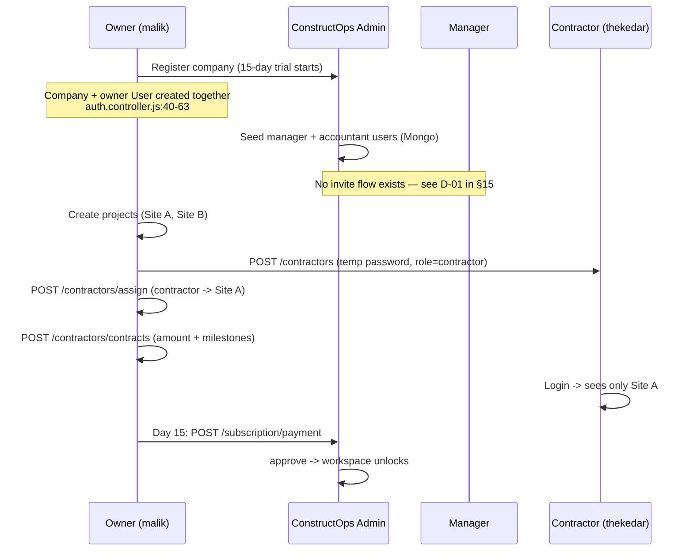
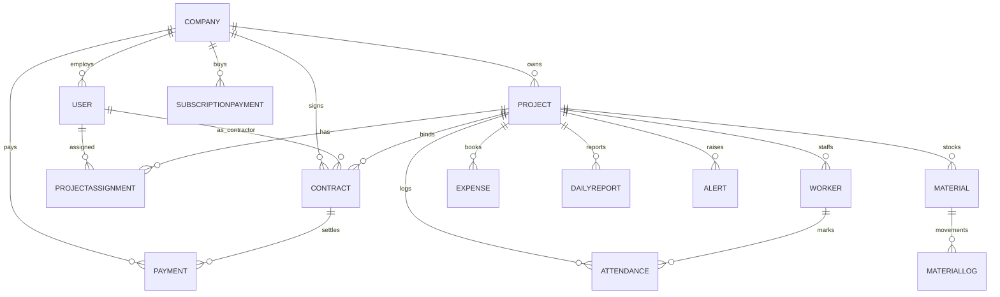
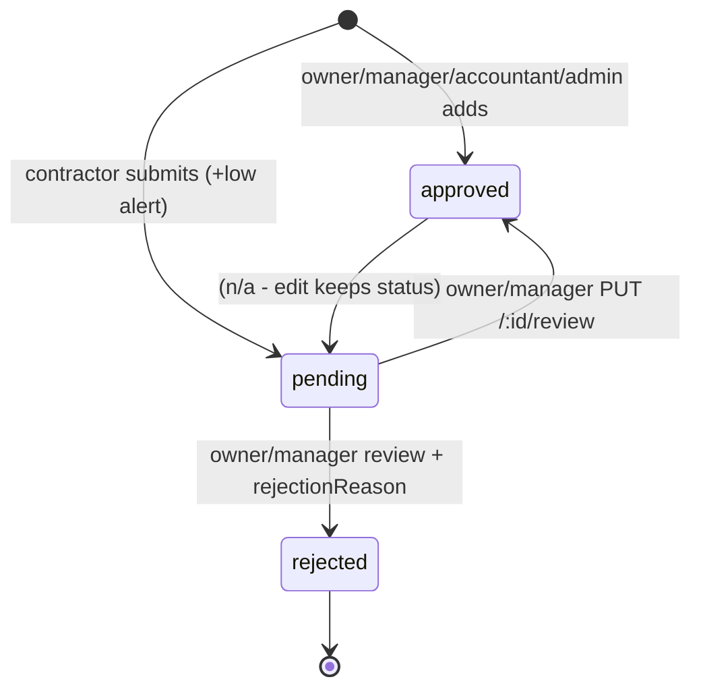
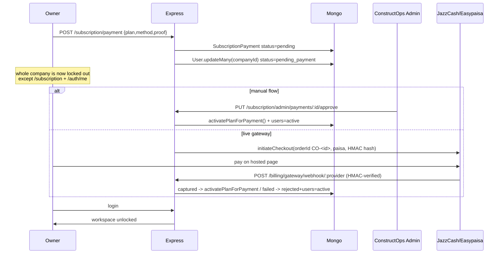

# ConstructOps — Complete System, Requirements, Team & Workflow Guide

**Version:** 1.0 (as-built)
**Generated:** 2026-10-13
**Source of truth:** the code in `backend/` and `frontend/`, not the planning docs.
Every claim below has a `file:line` reference so you can verify it in seconds.

> **Read this first:** `backend/.planning/` still says "Phase 1 of 4, 0% complete, ready to plan".
> That is stale. The product is functionally complete for all four planned phases *plus* four
> modules that were never in the plan (billing, contractor/contract management, admin console,
> exports). Section 4 reconciles the two.

---

## Table of contents

1. [Product snapshot](#1-product-snapshot)
2. [Team structure and roles](#2-team-structure-and-roles)
3. [Requirements — clarified and traced](#3-requirements--clarified-and-traced)
4. [Architecture](#4-architecture)
5. [Data model](#5-data-model)
6. [End-to-end workflows](#6-end-to-end-workflows)
7. [Business rules and invariants](#7-business-rules-and-invariants)
8. [API reference](#8-api-reference)
9. [Frontend / UI map](#9-frontend--ui-map)
10. [Billing and subscription model](#10-billing-and-subscription-model)
11. [Exports](#11-exports)
12. [AI assistant](#12-ai-assistant)
13. [Configuration and runbook](#13-configuration-and-runbook)
14. [Security posture](#14-security-posture)
15. [Defect register (known bugs and gaps)](#15-defect-register-known-bugs-and-gaps)
16. [Prioritised fix roadmap](#16-prioritised-fix-roadmap)
17. [Glossary](#17-glossary)

---

## 1. Product snapshot

| | |
|---|---|
| **What** | Multi-tenant SaaS for construction site control: budget, expenses, material stock, labour attendance, daily site reports, automatic theft/delay alerts, Excel+PDF exports, in-app AI assistant, paid subscriptions. |
| **For whom** | Builders, developers and contractors in Pakistan (PKR-native, Roman-Urdu aware), plus their site managers, office accountants and subcontractors. |
| **Core value** | "Control construction site operations, budgets, materials, and labor from anywhere with real-time tracking and automated theft/mismatch detection." (`backend/.planning/PROJECT.md`) |
| **Stack** | Node.js 24 + Express 4 + MongoDB/Mongoose 8 (ESM) · React 18.3 + Vite 5 · JWT auth · ExcelJS + PDFKit · bcryptjs |
| **Money** | 15-day free trial → Rs 15,000 / month · Rs 75,000 / 6 months · Rs 135,000 / 12 months (`backend/src/utils/subscription.util.js:67-71`) |
| **Data isolation** | `Company` is the tenant. Every read/write is filtered by `companyId`, and every `/projects/:id...` route passes `checkProjectAccess()`. |
| **Repo** | `backend/` (self-contained), `frontend/` (self-contained), docs in `backend/docs/`, planning in `backend/.planning/`. |

**Scale today:** ~50 backend source files, 15 collections, 14 route modules, ~65 endpoints, 7 React pages/components-of-record. No tests, no CI, no migrations tooling.

---

## 2. Team structure and roles

There are **two distinct teams** touching this system. Mixing them up is the single most common source of confusion, so they are separated below.

### 2.1 The two teams



* **Platform team** owns the software, the admin console, and payment verification. Their identity in the system is the single virtual **`admin`**.
* **Customer team** is the construction company. Their identities are the four real DB roles: `owner`, `manager`, `accountant`, `contractor`.
* **Workers** (mason, electrician, helper…) are *data*, not users. They never log in; the site team records for them.

### 2.2 Identity model as implemented

| Identity | Where it lives | How created | Token |
|---|---|---|---|
| `admin` | **not in the database** — a JWT claim only | hard-coded credentials, `auth.controller.js:105-106` and `241-242` | 1 day, `{role:'admin', email}` with no `id` (`auth.controller.js:110-114`) |
| `owner` | `users.role` enum (`user.model.js:23-27`) | self-service registration; auto-assigned (`auth.controller.js:63`) | 7 days (`auth.controller.js:9-13`) |
| `manager` | same enum | **cannot be created by the app** — must be inserted in the DB, or registered as owner then edited. No "invite teammate" API exists for manager/accountant. | 7 days |
| `accountant` | same enum | same as manager — DB-side only | 7 days |
| `contractor` | same enum | owner/manager via `POST /api/v1/contractors` (`contractor.controller.js:12-47`) | 7 days |

The `User` enum is `['owner','manager','accountant','contractor']` with default `owner`. `admin` is deliberately **absent** from it, which has a real consequence: an admin token passes `protect` but fails almost every `authorize(...)` gate, because `admin` is not in those lists (`auth.middleware.js:134-144`). Admins therefore use their own dedicated routes (`/users`, `/subscription/admin/*`, `/dashboard`), not the company routes.

### 2.3 Role-by-role detail

#### Owner — malik / builder-developer
* **Real person:** the firm owner or MD who signs the cheques.
* **Visible in UI:** full sidebar (Company Dashboard, Projects, Contractors), all 7 tabs of ProjectDetail, "New Project", "Complete" button, expense Approve/Reject, contract creation, contractor account creation and assignment.
* **Can do that others cannot:** delete a project (`project.routes.js` — `authorize('owner')`), delete a daily report (`report.routes.js`), delete an expense (`finance.routes.js` — `owner,contractor`).
* **Owns the billing relationship:** submits the subscription payment, sees the plan pill in the navbar, unlocks the workspace by paying.
* **Auto-approval power:** any expense the owner (or manager, accountant, admin) records is `approved` immediately (`expense.controller.js:90-100`).
* **Blind spots:** none within its own company.

#### Manager — Site Manager / Projects Manager
* **Real person:** the salaried site or project engineer running day-to-day execution, sometimes at head office.
* **Identical day-to-day powers to owner:** add workers, mark attendance, register materials, log stock IN/OUT, submit reports, record expenses (auto-approved), review/approve expenses, create+assign contractors, save contracts.
* **Cannot:** delete projects, delete reports, delete expenses, disburse contractor payments (route allows `owner,accountant` only — `contractor.routes.js` `POST /payments`), submit the subscription payment (any company user can technically post it; treat it as owner-only by policy).
* **Key limitation to design around:** manager scope is **company-wide, not per-project**. There is no way to give a manager only Site A. If you hire a manager, they see every site of the company.

#### Accountant — office / chief accounts
* **Real person:** the office finance staff who posts bills and pays subcontractors.
* **Financial authority:** adds and edits expenses (auto-approved), and is the *only* role besides owner/admin that can **disburse contractor payments** (`authorize('owner','accountant')` on `POST /contractors/payments`). Reads contracts and payment ledgers.
* **Hard-blocked (both UI and API):** worker CRUD, attendance marking, material registration and stock logging, daily report creation. Enforced in the backend (`authorize('owner','manager','contractor')` on those routes) and mirrored in the UI (`ProjectDetail.jsx:720`, `793`, `873`).
* **Cannot approve or reject expenses** — review is `owner,manager` only (`finance.routes.js` + `expense.controller.js:184-186`). Rejection is a management decision by design.
* **Cannot delete expenses** — delete allows `owner,contractor` only.
* **Navigation:** sidebar hides Dashboard and Contractors links for accountant (`Sidebar.jsx:90-126`), but the `/dashboard` *route* is not path-guarded, so an accountant typing the URL gets the company dashboard (backend `/dashboard` is company-scoped for any authenticated company user, `dashboard.routes.js:12`). Treat this as soft-hiding, not access control.

#### Contractor — thekedar / subcontractor
* **Real person:** the masonry/electrical/HVAC subcontractor working under a written contract on one or more of the company's sites.
* **Visibility:** only projects with an **active** `ProjectAssignment` (`project.controller.js:43-73`, `projectAccess.middleware.js:64-79`). Cannot see other sites, other contractors, or company totals.
* **Powers on assigned sites:** add/edit/delete own workers, mark attendance, register and log materials, post daily reports, submit expenses.
* **Expense difference:** contractor-submitted expenses land as **`pending`** and generate a low-severity alert for the owner (`expense.controller.js:104-111`); they do **not** touch `project.spent` until approved.
* **Financial self-service:** read-only contract statement and payment history (Contracts tab, `ProjectDetail.jsx:1157-1294`) — contract value, total received, balance due, instalment count. Scoped to `contractorId: self` server-side (`contractor.controller.js:235-238`).
* **Cannot:** create projects, see the company dashboard, hire/fire other contractors, sign their own contract, pay themselves, delete an already-approved expense (`expense.controller.js:284-291`).

#### Worker — mistri / mazdoor (not a user)
* **Record:** `name`, free-text trade `role` (mason, electrician, plashter, helper, bar-binder, crane operator…), `dailyWage` PKR, `phone` (`worker.model.js`).
* **Lifecycle:** created by owner/manager/contractor on the site → marked present/absent daily → drives labour cost. Payable wages are computed at export time as `presentDays × dailyWage` (`exportData.js:214-227`) — there is no payroll record in the DB.

#### Admin — ConstructOps platform
* **Real person:** you, or support/billing staff.
* **Powers:** list all users (`GET /users`), ban/deactivate/delete/clear-data a tenant (`PUT /users/:id/status`, `DELETE /users/:id`, `DELETE /users/:id/clear-data` — all `user.routes.js:26-114`), view and approve/reject every subscription payment (`subscription.routes.js:19-22`), manually renew a subscription (`POST /subscription/renew`), see every project of every company (`auth.middleware.js:30-38` bypasses tenant checks).
* **Cannot:** use the AI assistant (explicitly rejected, `assistant.controller.js:34-36`) and cannot post a subscription payment for a company (`subscription.controller.js:76-78`).
* **Sees a synthetic subscription:** `enterprise / active / 9999 days` (`subscription.controller.js:268-282`).

### 2.4 Permission matrix (verified against code)

Y = allowed, — = blocked by backend (`authorize`/middleware) or hidden in UI.

| Capability | admin | owner | manager | accountant | contractor |
|---|:--:|:--:|:--:|:--:|:--:|
| Register a company / login | ✔ backdoor | ✔ | — (DB-seeded) | — (DB-seeded) | ✔ (created by owner) |
| See projects | all | company | company | company | assigned only |
| Create project | —* | ✔ | ✔ | — | — |
| Edit project / progress | —* | ✔ | ✔ | — | — |
| Delete project | ✔ (via `/users`) | ✔ | — | — | — |
| Project dashboard | ✔ | ✔ | ✔ | ✔ | assigned only |
| Company dashboard `/dashboard` | ✔ | ✔ | ✔ | ✔ (URL only, hidden in nav) | ✔ (company aggregate — **leak**: no role filter, `dashboard.routes.js`) |
| Add / edit / delete worker | —* | ✔ | ✔ | — | ✔ |
| Mark attendance | —* | ✔ | ✔ | — | ✔ |
| Register material / log IN-OUT | —* | ✔ | ✔ | — | ✔ |
| Add expense | —* | ✔ auto-approved | ✔ auto-approved | ✔ auto-approved | ✔ **pending** |
| Edit expense | — | ✔ | ✔ | ✔ | own, unapproved only |
| Delete expense | — | ✔ | — | — | own, unapproved only |
| Approve / reject expense | —* | ✔ | ✔ | — | — |
| Create contractor account | ✔ (status) | ✔ | ✔ | — | — |
| Assign / revoke contractor | — | ✔ | ✔ | — | — |
| Save contract + milestones | — | ✔ | ✔ | — | — |
| View contract statement | all | ✔ | ✔ | ✔ | own only |
| Disburse contractor payment | — | ✔ | — | ✔ | — |
| View payments | all | ✔ | ✔ | ✔ | own only |
| Post daily report + photos | —* | ✔ | ✔ | — | ✔ |
| Delete daily report | — | ✔ | — | — | — |
| Read alerts | all | ✔ | ✔ | ✔ | own projects |
| Mark alert read | ✔ | ✔ | ✔ | ✔ | ✔ |
| Export project / company | — | ✔ | ✔ | ✔ | ✔ (scoped) |
| AI assistant | — (blocked) | ✔ | ✔ | ✔ | ✔ |
| Approve subscription payment | ✔ | — | — | — | — |
| Submit subscription payment | ✔ (`renew`) | ✔ | ✔ | ✔ | ✔ (**policy gap**) |
| Ban / wipe a tenant | ✔ | — | — | — | — |

\* `admin`'s JWT role is not in these `authorize()` lists, so admin cannot perform these company-route actions; admin has its own endpoints instead.

### 2.5 Who creates whom — onboarding sequence



**Practical staffing recipes**

| Firm size | Recommended setup |
|---|---|
| Single site, owner hands-on | 1 owner. Owner does everything; accountant optional. |
| 2-3 sites | 1 owner + 1 manager (sees all sites) + 1 accountant (bills + pays thekas) + contractors per trade, each assigned to the sites they work. |
| 4+ sites / multi-city | Owner stays on dashboard + approvals only. One manager per region is **not** currently expressible (company-wide scope), so either accept shared visibility or split into separate company accounts (one subscription each). |
| Owner who travels | Contractor logins for the major thekas: they self-report attendance, material receipts and expenses; owner only approves. This is the highest-leverage setup for theft control. |

### 2.6 Operating rhythm — a real day on ConstructOps

| Time | Actor | Action | System effect |
|---|---|---|---|
| 08:15 | Manager / contractor | Workers tab → Present/Absent for today | `Attendance` upsert per worker per day (`worker.controller.js:131-171`) |
| 09:30 | Material in-charge | Materials → log **IN** (cement 200 bags) | `MaterialLog` IN, `totalIn`/`remaining` increased |
| 12:00 | Site engineer | Materials → log **OUT** (usage) | `remaining` decreased; if it goes negative → **high `material` theft alert** (`material.controller.js:141-148`) |
| 14:00 | Contractor | Expenses → submit transport bill with note | Expense `pending` + low-severity budget alert; spent untouched |
| 17:30 | Site engineer | Daily Reports → description + 3-6 photos | keyword scan → delay alert and/or `progress +5` (`report.controller.js:38-85`) |
| 20:00 | Owner | Overview tab → Approve/Reject pending bills | approved → `syncProjectSpent` recomputes `project.spent`; overrun → high `budget` alert |
| Weekly | Owner/manager | Export Excel → Materials + Movement sheets | audit trail `createdBy` per movement |
| Monthly | Accountant | Export Excel → Labour sheet `payableWages` | wages = present days × daily wage |
| Day 15/30/… | Owner | Renew plan in navbar | trial → pending → admin approves → active |

### 2.7 Delivery-team / code-ownership map

If you split work across developers, the natural ownership boundaries are:

| Area | Files | Change risk |
|---|---|---|
| Auth + guards | `auth.controller.js`, `auth.middleware.js`, `projectAccess.middleware.js`, `user.model.js`, `company.model.js` | **Critical** — every rule and every tenant boundary lives here |
| Money (project) | `expense.*`, `contractor.*`, `payment.model`, `contract.model` | Critical — `syncProjectSpent` is the ledger truth |
| Money (platform) | `subscription.*`, `paymentGateway.service.js`, `subscriptionActivation.service.js`, `gatewayWebhook.controller.js`, `pakBanks.js` | Critical — cash flow |
| Site ops | `worker.*`, `attendance.model`, `material.*`, `materialLog.model`, `dailyReport.model`, `report.controller.js` | Medium |
| Analytics | `dashboard.routes.js`, `project.controller.js#getProjectDashboard`, `exportData.js` | Medium — mostly read + self-healing writes |
| Export | `exportWorkbook.js`, `exportPdf.js`, `export.controller.js` | Low |
| Assistant | `assistant.service.js`, `assistant.controller.js`, `languages.js` | Low (read-only) |
| Frontend shell | `App.jsx`, `Layout.jsx`, `Navbar.jsx`, `Sidebar.jsx`, `api.js`, `index.css` | Medium |
| Frontend features | `ProjectDetail.jsx` (1,860 lines — the real product), `Dashboard.jsx`, `Contractors.jsx`, `SubscriptionModal.jsx`, `AssistantChat.jsx` | Medium |

---

## 3. Requirements — clarified and traced

### 3.1 Status legend

| Mark | Meaning |
|---|---|
| **MET** | implemented and reachable from the UI; behaves as specified |
| **PARTIAL** | implemented but with a material shortfall or a caveat |
| **NOT MET** | planned but not implemented |
| **UNPLANNED** | shipped but absent from `REQUIREMENTS.md` (scope that emerged during build) |

### 3.2 Original v1 requirements, one by one

#### Authentication & Authorization

| ID | Requirement | Status | Evidence / note |
|---|---|---|---|
| AUTH-01 | Register with name, email, password, role, company name | **PARTIAL** | `auth.controller.js:18-91`. Registration always creates role `owner` (`:63`) — the requester cannot choose manager/accountant, and no invite flow exists for those two. Company is auto-created with a 15-day trial (`:40-53`). |
| AUTH-02 | Login with email+password, receive JWT | **MET** | `auth.controller.js:96-189`; HS256, 7-day expiry (`:9-13`). |
| AUTH-03 | Role-restricted endpoints | **MET** | `authorize()` (`auth.middleware.js:134-144`) + `checkProjectAccess()` (`projectAccess.middleware.js:15-89`). Full matrix in §2.4. |
| AUTH-04 | Session persists across reload via localStorage token | **MET** | `Login.jsx:37-45`, `api.js:12-23`, `Layout.jsx:33-52`. On 401 the token is cleared and the browser is redirected (`api.js:26-39`). |
| AUTH-05 (v2) | OAuth / password recovery | **NOT MET** | absent — no reset endpoint, no mail provider. |

> **Spec conflict to settle:** AUTH-03's note says "Accountant has Expense-only access". As built, the accountant also has **contract disbursement** (`POST /contractors/payments`) and project/contract read access. Decide which is the product truth and update the other.

#### Dashboard

| ID | Requirement | Status | Evidence / note |
|---|---|---|---|
| DASH-01 | Totals: projects, budget vs spent, workers, alerts | **MET** | `Dashboard.jsx:298-334` fed by `GET /dashboard` (`dashboard.routes.js`). |
| DASH-02 | Completion % progress bars | **MET** | `SvgBarChart` (`Dashboard.jsx:15-69`) + per-card bar (`Projects.jsx:141-156`). |
| DASH-03 | Interactive expense-over-time chart | **PARTIAL** | A planned-vs-actual line chart exists (`SvgLineChart`, `Dashboard.jsx:71-138`) but it is **static SVG (no interactivity)** and its "planned" series is a formula (`budget/12*month*0.8`) with **faked Jan-Mar demo values injected when data is empty** (`dashboard.routes.js:72-78`). |
| DASH-04 | Alerts panel | **MET** | Overview tab feed + navbar bell polling every 20 s (`Navbar.jsx:25-29`, `ProjectDetail.jsx:686-709`). |

#### Project Management

| ID | Requirement | Status | Evidence / note |
|---|---|---|---|
| PROJ-01 | Create project with location, budget, target date, description | **PARTIAL** | `project.controller.js:15-38`. Fields are name/location/budget/startDate/endDate — **no `description` field exists** on `Project`. |
| PROJ-02 | Responsive project list | **MET** | `Projects.jsx` card grid + 1024/600 px breakpoints. |
| PROJ-03 | Detail split into tabs (Overview, Reports, Workers, Materials, Expenses) | **MET+** | `ProjectDetail.jsx` has **7** tabs — the 5 planned plus Contracts & Payments and Contractor Assignments. |

#### Worker & Attendance

| ID | Requirement | Status | Evidence / note |
|---|---|---|---|
| WORK-01 | Add worker with name, trade, daily wage, phone | **MET** | `worker.model.js`, `worker.controller.js:9-38`. |
| WORK-02 | Mark present/absent for a date | **MET** | `POST /workers/attendance/check-in`, upsert semantics (`worker.controller.js:131-171`). |
| WORK-03 | Weekly/monthly salary report | **PARTIAL** | `payableWages = presentDays × dailyWage` is computed **only inside exports** (`exportData.js:214-227`), and there is no period picker (week/month) anywhere. No payroll record, no paid/unpaid state. |

> **Integrity risk:** the unique index is `{workerId, date}` — **`projectId` is not in the key** (`attendance.model.js:38`) although the comment claims "per day per project". A worker double-booked across two sites silently shares one attendance row.

#### Material Tracking

| ID | Requirement | Status | Evidence / note |
|---|---|---|---|
| MATR-01 | Inventory: IN / used / remaining | **MET** | `material.model.js`, `ProjectDetail.jsx:869-969`. |
| MATR-02 | Log IN/OUT with quantity + audit note | **MET** | `material.controller.js:89-157`; every movement stores `createdBy`, and the ledger is append-only (`MaterialLog` is never edited). |
| MATR-03 | Theft warning when usage exceeds standard | **PARTIAL** | Fires only when `remaining < 0` (`material.controller.js:141-148`). There is **no "estimated standard consumption"** concept — cement-per-sqft style norms were never modelled, so over-use *within* available stock raises no flag. |

#### Expenses

| ID | Requirement | Status | Evidence / note |
|---|---|---|---|
| EXPS-01 | Log expense (amount, date, description, category) | **MET+** | `expense.controller.js:45-122`; 9 categories (material, labor, machinery, transport, subcontractor, utilities, permits, safety, misc) instead of the planned 4, plus `receiptUrl`, `status`, `reviewedBy`, `rejectionReason`. |
| EXPS-02 | Budget vs actual with progress indicator | **MET** | Budget-utilisation bar + 9-bucket category breakdown (`ProjectDetail.jsx:561-713`). |

#### Daily Reports & AI insights

| ID | Requirement | Status | Evidence / note |
|---|---|---|---|
| REPT-01 | Daily log + photos + work type | **MET** | `report.controller.js:9-105`, work type enum Foundation/Structure/Slab/Finishing/Other. |
| REPT-02 | AI analyses **uploaded photos** for progress/delay | **NOT MET** | No image is ever examined. `aiAnalysis` is produced by **keyword matching on the text description only** (`report.controller.js:43-85`). Photos are stored and rendered (`ProjectDetail.jsx:744-755`) but never analysed. |
| REPT-03 | Roman-Urdu **voice** transcription input | **NOT MET** | Zero Web Speech code in the frontend. `GET /assistant/voice-config` exists (`assistant.controller.js:75-85`) and is **never called**. A dead `handleVoiceSimulate` remains in `ProjectDetail.jsx:433-442` and would throw if invoked (it references undefined setters). |
| VOIC-01 (PROJECT.md) | Hands-free Urdu/Roman-Urdu reporting | **NOT MET** | same as REPT-03. |

### 3.3 Requirements added during the build (not in REQUIREMENTS.md)

These are real, shipped, and used — the plan simply never caught up.

| New ID | What | Where |
|---|---|---|
| SUBS-01 | 15-day automatic trial on registration | `auth.controller.js:40-53`, `company.model.js:24-39` |
| SUBS-02 | Three paid plans, PKR pricing | `subscription.util.js:57-75` |
| SUBS-03 | Manual payment proof: bank transfer (26 Pakistani banks + IBAN validation), JazzCash/Easypaisa TID, card last-4 | `subscription.controller.js:36-161`, `pakBanks.js:47-77` |
| SUBS-04 | Live gateway checkout (JazzCash/Easypaisa) with HMAC secure-hash + signed webhook | `paymentGateway.service.js`, `gatewayWebhook.controller.js` |
| SUBS-05 | **Workspace lock** — whole company locked while a payment is under verification, and suspended on expiry | `subscription.controller.js:107`, `auth.middleware.js:48-93`, `Layout.jsx:91-141` |
| SUBS-06 | Admin approval queue with approve/reject + manual renew | `subscription.routes.js:19-22` |
| CONT-01 | Subcontractor accounts (role `contractor`) | `contractor.controller.js:12-47` |
| CONT-02 | Per-project contractor assignment with soft revoke | `projectAssignment.model.js`, `contractor.controller.js:90-173` |
| CONT-03 | Contract with milestones (pending/completed/paid) | `contract.model.js:33-53`, `contractor.controller.js:178-217` |
| CONT-04 | Contractor payment ledger + balance due | `payment.model.js`, `contractor.controller.js:252-319` |
| CONT-05 | Contractor self-service statement (read-only) | `ProjectDetail.jsx:1157-1294` |
| ADM-01 | Admin console: user list, ban/deactivate, delete, clear-data | `user.routes.js:12-114` |
| ADM-02 | Tenant cascade delete | `cascadeDelete.service.js:35-77` |
| EXP-01 | Excel + PDF export, project-scoped and company-scoped | `exportData/exportWorkbook/exportPdf` |
| ASST-01 | Multilingual in-app assistant over tenant data (LLM + offline fallback) | `assistant.service.js` |
| I18N-01 | 3 language codes (`en`, `latn-ur`, `arab-ur`) on the user profile | `languages.js:3-7`, `user.model.js` |

### 3.4 Non-functional requirements, as built

| NFR | Status | Detail |
|---|---|---|
| Multi-tenancy isolation | **MET** | `companyId` filter on every query + `sameId()` normalisation (`utils/ids.js:9-13`); contractor assignment gate. |
| Audit trail | **PARTIAL** | `addedBy`, `createdBy`, `recordedBy`, `reviewedBy/reviewedAt` exist. There is **no immutable history** for edits (updating an expense overwrites the old value) and no login/failed-attempt log. |
| Availability / resilience | **PARTIAL** | Server listens even if Mongo is down and retries per request (`server.js:19-21`, `app.js:75-82`); graceful SIGTERM drain (`server.js:28-41`). No health check of the DB, no readiness probe, no process supervisor config. |
| Performance | **PARTIAL** | Indexes on tenant/project/status keys; export caps images (80 images / 12 MB Excel, 24 images / 8 MB / 120 pages PDF). But **daily-report photos are base64 strings inside MongoDB documents** — documents approach the 16 MB limit fast and every report read drags payloads. |
| Security | **PARTIAL** | see §14; two blockers (hard-coded admin credentials, no rate limiting). |
| Testability | **NOT MET** | zero tests, no lint on backend, no CI, no seed script. |
| Observability | **NOT MET** | `morgan` disabled in production (`app.js:60-62`); errors logged to stdout only; the frontend silences `console` and swallows all runtime errors (`antiInspect.js:17-28`). |
| Data correctness | **PARTIAL** | `project.spent` is derived, not trusted (recomputed on every mutation and self-healed on read, `expense.controller.js:9-40`, `project.controller.js:216-219`). Good — but legacy `status:null` expenses are counted as approved (see §7). |

### 3.5 Out of scope — unchanged

Per `REQUIREMENTS.md`: multi-company collaboration (one `Company` per registration — still true, `user.companyId` is a single ref), subcontractor **bid management** (contracts exist, bidding/tendering does not), face-recognition attendance, WhatsApp/SMS notifications, receipt OCR.

### 3.6 Net requirement position

**22 planned v1 requirements: 13 MET, 6 PARTIAL, 3 NOT MET** (REPT-02 AI vision, REPT-03 voice, and one of the DASH items counted as partial). 16 additional capabilities shipped unplanned. The planning docs' progress table ("Phase 1: 0/3, Not started") is wrong on every line and should be regenerated or deleted so it stops misleading readers.

---

## 4. Architecture

### 4.1 Topology

```
Browser (React SPA, :3000)
   │  axios, Authorization: Bearer <localStorage.token>
   ▼
Vite dev proxy  /api → http://127.0.0.1:5000      (vite.config.js:18-23)
   ▼
Express API  /api/v1/*  (:5000)
   ├─ CORS allowlist → security headers → express.json(+rawBody) → morgan(dev)
   ├─ GET /health  (public)
   ├─ lazy connectDB() on every request
   ├─ protect  ──► checkProjectAccess() ──► authorize(role) ──► controller
   └─ services: paymentGateway · subscriptionActivation · assistant · export · cascadeDelete
   ▼
MongoDB (Mongoose 8, 15 collections)
```

### 4.2 Startup (`backend/server.js`)
`dotenv` first (L2) → import app + mongoose → `PORT` default 5000 (L8) → `uncaughtException`/`unhandledRejection` handlers **log only, never exit** (L10-16) → `connectDB()` fired but failure tolerated (L19-21) → `listen` → SIGINT/SIGTERM: `server.close()` → `mongoose.disconnect()` → exit 0, forced exit after 10 s (L28-41).

### 4.3 Request pipeline (`backend/src/app.js`)
1. CORS from `CORS_ORIGIN` allowlist; requests with no `Origin` pass; in development any `localhost`/`127.0.0.1` port passes (L37-47).
2. Security headers `nosniff` / `X-Frame-Options: DENY` / `Referrer-Policy: no-referrer` (L49-54). No helmet.
3. `express.json({limit:'10mb', verify: capture req.rawBody})` — raw body is kept for webhook HMAC (L57); urlencoded 10 mb (L58).
4. `morgan('dev')` when not production (L60-62).
5. `GET /api/v1/health` public (L65-71).
6. Lazy `connectDB()` per request (L75-82).
7. 14 route mounts (L85-98, full table in §8).
8. 404 then JSON error handler: statusCode 200→500, CORS error→403, full error logged server-side, client sees only `{success:false,message}` (L101-118).

### 4.4 Auth guard chain (`src/middleware/auth.middleware.js`)
`protect` (L15-105) in order: parse Bearer → `jwt.verify` → **if `decoded.role==='admin'`, synthesise `req.user={_id:'admin_id_mock',role:'admin'}` and skip all status logic** (L30-38) → else load user + populate company → subscription check → three gates:

| Gate | Condition | Effect | Escape routes |
|---|---|---|---|
| Expired (L48-72) | `endDate <= now` or status `expired/banned` | persist company `expired` + user `banned`, return 403 `subscriptionExpired:true` | URL contains `/api/v1/subscription`, `/api/v1/auth/me`, `/api/v1/auth/language` |
| Pending payment (L76-85) | `user.status==='pending_payment'` | 403 `paymentPending:true` | URL contains `/api/v1/subscription` or `/api/v1/auth/me` |
| Manual ban (L88-93) | `status==='banned'` while subscription valid | 403 "deactivated by System Admin" | none |

`verifyAdmin` (L108-131) re-verifies the same header and requires `role==='admin'`. `authorize(...roles)` (L134-144) checks `req.user.role`.

### 4.5 Tenant gate (`src/middleware/projectAccess.middleware.js`)
`router.use('/:id', checkProjectAccess())` on project routes (L18) means **every** `/projects/:id...` request passes this before the controller. Project id resolution order: `params.projectId → params.id → body.projectId → query.projectId` (L25/35). Admin bypasses (L24-33). Missing id → 400; unknown → 404; company mismatch → 403 (L48-53). Contractor needs an **active** `ProjectAssignment`, which is attached as `req.projectAssignment` (L64-79). `requireOwnerOrManager` (L95-103) is exported but unused.

---

## 5. Data model

No schema sets a custom collection name; Mongoose pluralises (`companys`, `dailyreports`, `materiallogs`…). No virtuals, no statics; the only hook is the User password pre-save, the only instance method `comparePassword`.



### 5.1 Collections

| Collection | Key fields (type / required / default / enum) | Indexes | Purpose |
|---|---|---|---|
| `companies` | `name` req trim; `subscriptionPlan` enum trial\|1_month\|6_months\|12_months\|free\|pro\|enterprise (default `trial`; last three are dead legacy); `subscriptionStatus` active\|expired\|banned (active); `subscriptionStartDate` now; `subscriptionEndDate` **now+15d** (L24-27); `trialStartDate` now; `trialEndDate` now+15d; `isTrial` true | — | The tenant + billing subject |
| `users` | `name`; `email` unique lowercase; `password` (bcrypt 10, pre-save L50-57); `role` owner\|manager\|accountant\|contractor (owner); `companyId` ref, not required; `status` active\|banned\|deactivated\|pending_payment (active); `language` en\|latn-ur\|arab-ur (en) | `email` unique | Identity + lockout state |
| `projects` | `companyId` req; `name`; `location`; `budget` req 0; `spent` req 0; `startDate`; `endDate`; `status` active\|completed\|paused (active); `progress` 0-100 (0) | companyId | Unit of site work; `spent` is derived |
| `projectassignments` | `companyId`; `projectId`; `contractorId`→User; `role` free text (default `contractor`); `status` active\|revoked (active); `assignedBy` | unique `{projectId,contractorId}` (L45) | Contractor visibility scope |
| `contracts` | `companyId`; `projectId`; `contractorId`; `contractAmount` 0; `terms`; `milestones[] {title req, amount req, dueDate, status pending\|completed\|paid}` (L33-53); `status` active\|completed\|terminated | companyId, projectId | Subcontract agreement |
| `payments` | `companyId` req; `projectId` req; `contractorId` req; `contractId`; `amount` req; `paymentDate` now; `status` scheduled\|paid (paid); `paymentMethod` bank_transfer\|cheque\|cash\|other; `referenceNumber`; `notes`; `recordedBy` req | — | Money out to a subcontractor — **not** an expense |
| `workers` | `projectId` req; `name` req; `role` req (free text trade); `dailyWage` req; `phone` req | projectId | Labour roster |
| `attendances` | `workerId` req; `projectId` req; `date` req; `status` present\|absent (present); `checkInTime` now | **unique `{workerId,date}`** (L38) | Daily presence — drives wage calc |
| `materials` | `projectId` req; `name` req; `unit` req (bags); `totalIn` 0; `totalUsed` 0; `remaining` 0 | unique `{projectId,name}` (L40) | Current stock position |
| `materiallogs` | `projectId`; `materialId`; `type` IN\|OUT; `quantity`; `date`; `note`; `createdBy` | — | Append-only movement ledger |
| `expenses` | `companyId` (not req); `projectId` req; `category` 9-value enum req; `amount` req min 0; `description` req; `date`; `receiptUrl`; `status` pending\|approved\|rejected (pending); `addedBy` req; `reviewedBy`; `reviewedAt`; `rejectionReason` | `{projectId,status}` (L80) | Cost book + approval state machine |
| `dailyreports` | `projectId` req; `addedBy` req; `date`; `description` req; `workType` Foundation\|Structure\|Slab\|Finishing\|Other; `images[]` (base64 or URL); `aiAnalysis {progressDetected, delayRisk, notes}` (L35-48) | `{projectId,date:-1}` (L56) | Site diary |
| `alerts` | `projectId` req; `type` budget\|delay\|material\|worker; `message` req; `severity` low\|medium\|high (medium); `isRead` false | projectId | Auto-generated risk signals |
| `subscriptionpayments` | `companyId` req; `submittedBy` req; `plan` 1_month\|6_months\|12_months; `amount`; `currency` PKR; `method` card\|easypaisa\|jazzcash\|bank_transfer; `transactionReference` req; `payerDetails`; `bankInfo{bankName,bankCode,accountTitle,accountNumber,iban}` (L44-50); `gateway{provider,orderId,checkoutUrl,sessionExpiry,capturedAt}` (L51-57); `status` pending\|approved\|rejected; `reviewNote`; `reviewedAt` | `gateway.orderId` | The platform's only fiscal record (no invoice document) |

---

## 6. End-to-end workflows

### W1 — Company registration (self-service)
`POST /api/v1/auth/register` — public (`auth.routes.js`).
1. Validate name, email, password, companyName (`auth.controller.js:18-33`).
2. Password policy `/^(?=.*[A-Za-z])(?=.*\d)[A-Za-z\d]{8,}$/` — ≥8 chars, letters+digits. **Symbols are rejected** (`:28`).
3. Duplicate email → 400.
4. Create `Company` with `subscriptionPlan:'trial'`, `isTrial:true`, end = now+15 d (`:40-53`).
5. Create owner `User` (`role:'owner'`, language validated) → pre-save bcrypt (`user.model.js:50-57`).
6. Return 7-day JWT + user DTO + subscription details.
7. Frontend writes `localStorage.token`/`user` and routes to `/projects` (`Register.jsx:23-27`).

### W2 — Login and gate resolution
`POST /api/v1/auth/login`.
1. **Admin branch first:** email `constops@admin.com` + hard-coded password → 1-day admin JWT, no DB lookup (`auth.controller.js:104-125`). `POST /admin/login` duplicates it (`:237-266`); the frontend routes that exact email there (`Login.jsx:31-35`).
2. Normal branch: lowercase email → populate company → `comparePassword`.
3. `status==='pending_payment'` → 403 `paymentPending` (`:140-146`); Login shows the amber "Payment submitted successfully" box when arriving with `?payment=pending` (`Login.jsx:13-18`).
4. Subscription expired → persist company `expired` **and user `banned`**, then 403 (`:149-163`).
5. Success → token + user DTO with `subscription`.

### W3 — Project lifecycle
`POST /projects` (owner/manager) sets `spent:0`, `companyId` from token (`project.controller.js:15-38`). `GET /projects` is three-way: admin→all, contractor→assigned ids ∩ own company, others→company (`:43-73`). `PUT /:id` whitelists name/location/budget/startDate/endDate/status/progress with `runValidators:true` (`:118-145`) and blocks contractors (`:131-133`). "Complete" in the UI sets `{progress:100,status:'completed'}` (`ProjectDetail.jsx:419-431`). `DELETE /:id` is **owner-only** and deletes the project + its assignments only (`:150-170`) — workers, expenses, materials, reports, contracts, payments and attendance are **orphaned** (defect D-06).

### W4 — Subcontractor onboarding → contract → payment
1. `POST /contractors` (owner/manager): dup-email check → `User{role:'contractor', companyId}` (`contractor.controller.js:12-47`). Temp password min 6 chars enforced only in UI (`Contractors.jsx:77-94`).
2. `POST /contractors/assign`: verifies project-company + contractor-company; **upsert** — an existing row flips to `status:'active'` (`:90-140`).
3. `POST /contractors/contracts`: upsert `{projectId,contractorId}` with amount/terms/milestones (`:178-217`).
4. `POST /contractors/payments` (owner/accountant only): creates `Payment{status:'paid', recordedBy}` (`:252-287`). **No side effect** on `project.spent` or contract — by design, subcontractor payments are not expenses.
5. Contractor opens Contracts tab → read-only statement (contract value / received / balance / instalments), server-scoped to `contractorId:self` (`:235-238`, `ProjectDetail.jsx:1157-1294`).
6. `POST /contractors/revoke` soft-revokes (`status:'revoked'`), history preserved (`:145-173`).

### W5 — Labour and attendance
Add worker (`POST /workers`, owner/manager/contractor) → daily `POST /workers/attendance/check-in {workerId,projectId,date,status}`. Date is normalised to **UTC midnight** (`worker.controller.js:149-150`); an existing `{workerId,date}` row is updated in place, otherwise created. `GET /workers/attendance?projectId&date` returns that day's roster with worker name/role/wage populated. Attendance drives export wages only; there is no payroll write-back.

### W6 — Material ledger and theft control

```
POST /materials {projectId,name,unit}            -> stock all zero
POST /materials/log {materialId,type:IN|OUT,quantity,note,createdBy}
    IN  -> totalIn+=q ; remaining+=q
    OUT -> totalUsed+=q ; remaining-=q
    if (type==OUT && remaining<0)
        -> ALERT{type:'material',severity:'high'}  (theft / unrecorded-IN warning)
```
(`material.controller.js:89-157`). Duplicate material names blocked case-insensitively (`:28`) plus unique index `{projectId,name}`. `GET /materials/logs` is the audit view with `materialId` and `createdBy` populated — the UI titles it "Stock Modification Audits (Fraud Prevention)" (`ProjectDetail.jsx:940-965`).

### W7 — Expense lifecycle (the approval state machine)


Every transition calls `syncProjectSpent(projectId)` (`expense.controller.js:9-40`): `project.spent = Σ expenses(status approved or null)`; if `spent > budget`, one deduped **high `budget` alert** is created (regex-matched on the message, so it fires once per project). Contractor rows are invisible to `spent` until approved. UI: submit modal (`ProjectDetail.jsx:1687-1743`), 9 client-side filter pills (`:990-1023`), Approve/Reject column rendered only for owner/manager/admin (`:1042`).

### W8 — Daily report + rule-based "AI"
`POST /reports {projectId,description,workType,images[]}` (`report.controller.js:9-105`):
* Delay keywords (`slow, delay, late, strike, absent, ruka, baarish, rain, khatam, chori, issue`) → `aiAnalysis.delayRisk=true`, `progressDetected=false`, **medium `delay` alert** quoting the first 60 chars (`:61-66`).
* Completion keywords (`completed, done, finish, ho gaya, complete, slab, foundation`) → `project.progress += 5` capped below 95 (`:81-84`).
* Images arrive as **base64 data URLs** built by FileReader in the browser (`ProjectDetail.jsx:372-382`). The modal also offers a "Mock URL" button that injects a hard-coded Unsplash photo (`:1802-1809`) — demo scaffolding, remove before real customers.
* No image analysis of any kind (REPT-02 unmet).

### W9 — Alert consumption
Generated inline by W6/W7/W8 (never by a background job). `GET /alerts[?projectId]` → latest 30, project name populated, company-scoped (`alert.controller.js:7-42`); `PUT /alerts/:id/read` verifies the alert's project belongs to the caller's company (`:47-71`). Consumed by: navbar bell (20 s poll), Overview feed, project dashboard payload, assistant context, export "Alerts" sheet. Type `worker` is declared but **nothing ever creates it**.

### W10 — Dashboards
`GET /dashboard` (company aggregate for the nav dashboard): project/worker counts, spent+pending, three hand-built chart datasets, and detailed lists (15 expenses, 15 reports, 30 workers) (`dashboard.routes.js`). Known defects there: `totalMaterialsQty` reduces a non-existent `m.quantity` field so it is always 0 (`:34`), and planned-vs-actual fabricates Jan-Mar when empty (`:72-78`).
`GET /projects/:id/dashboard` (`project.controller.js:175-292`): the ProjectDetail data source — approved/pending sums, 9-bucket category breakdown, worker count with today's attendance, unread alerts, latest 5 reports, contract, payments, assigned contractors — and it **self-heals `project.spent`** when the stored value disagrees (`:216-219`).

### W11 — Export
`GET /export/projects/:id/:format` and `GET /export/company/:format` (format `xlsx|pdf`), each behind `checkProjectAccess`. Pipeline `buildProjectExport/buildCompanyExport` → ExcelJS workbook / PDFKit A4-landscape → attachment with `Content-Disposition` filename `<slug>-<YYYY-MM-DD>.<ext>`, `Cache-Control: no-store`, and truncation counts in `X-Export-Warnings` (`export.controller.js:20-31`). Sheet/section detail in §11.

### W12 — Subscription lifecycle (the money path)


Plan end dates **stack**: activation extends from the existing end date when still active, else from now (`subscriptionActivation.service.js:16-20`). Reject or gateway-failure re-activates users if the plan is still valid, otherwise bans (`subscription.controller.js:248-251`). Expiry is enforced lazily at request time — **no cron** — so an unpaid company is stopped at its next API call, not at midnight. There is no cancel: paid time simply runs out.

### W13 — Admin operations
`GET /users` list with company populated; `PUT /users/:id/status` (`active|banned|deactivated`) which on ban **also wipes operational data** via `deleteCompanyData(...,{deleteCompany:false,deleteUsers:false})` (`user.routes.js:26-68`); `DELETE /users/:id` full wipe incl. company + all users; `DELETE /users/:id/clear-data` data-only wipe. `POST /subscription/renew` manual activation.

### W14 — Cascade delete (`cascadeDelete.service.js:35-77`)
Collects the company's project ids, then `Promise.allSettled` deleteMany across Worker, Expense (projectId **or** companyId), Material, MaterialLog, Alert, DailyReport, ProjectAssignment, Contract, Payment, Attendance, SubscriptionPayment; then Projects, optionally Users, optionally Company. Because it is `allSettled`, **partial failures are silently swallowed**.

### W15 — Assistant conversation
`POST /assistant/chat {messages,lang}` → sanitize (≤12 turns, ≤1000 chars) → `buildAssistantContext(user)` (tenant-scoped read-only JSON snapshot; caps projects 25, expenses 10, alerts 6) → if `ASSISTANT_API_KEY` set, try OpenAI-compatible chat completion (model `gpt-4o-mini`, temp 0.4, 600 tokens, 25 s timeout) → on any failure fall back to the deterministic multilingual knowledge engine → `{reply, lang, source:'llm'|'knowledge'}`. The assistant **never writes** to any model. Contractors receive only assigned projects + own expenses (`assistant.service.js:40-77`).

---

## 7. Business rules and invariants

These are the rules that make the numbers trustworthy; they are the ones to preserve when refactoring.

1. **`project.spent` is derived, never authored.** Recomputed by `syncProjectSpent` after every expense add/edit/delete/review (`expense.controller.js:9-40`) and repaired on read by the project dashboard (`project.controller.js:216-219`). No endpoint accepts `spent` in a request body (field whitelists).
2. **Approved-or-legacy-null counts as approved.** `status==='approved' || !status` (`expense.controller.js:19-21`, `dashboard.routes.js:38-47`). Legacy documents without status are in the money total — deliberate, but worth cleaning.
3. **Budget alerts are deduplicated by message regex** so a project gets one overrun alert, not one per expense (`expense.controller.js:23-28`).
4. **Subcontractor payments are not expenses.** `payments` never touches `spent`; contractor cost only enters the books when a labour expense is booked.
5. **One attendance row per worker per day** (unique `{workerId,date}`) — upsert, not insert.
6. **`MaterialLog` is the only mutator of `Material.remaining`** and is append-only; negative remaining is the theft signal.
7. **All ids compare through `sameId()`** (`utils/ids.js:9-13`) because populated Mongoose docs don't stringify to hex — a naive `===` breaks tenancy checks.
8. **Contractor visibility = active `ProjectAssignment` ∩ own company**, enforced in middleware, not in controllers (the controller checks in `getProjectById` are deliberately redundant).
9. **Writes use field whitelists** (`utils/pick.js`) — `companyId`, `addedBy`, `status`, `spent` cannot be injected.
10. **A pending subscription payment locks every user of the company** (`subscription.controller.js:107`), and unlocking happens only through approve/reject/webhook.
11. **Renewals stack on unexpired time; they do not restart it.**
12. **`project.progress` can only be raised by +5 per matching daily report (capped <95) or explicitly by owner/manager** — there is no automatic progress model.

---

## 8. API reference

All under `/api/v1`. 🔓 = no auth. `P` = `protect`, `A(...)` = `authorize(...)`, `V` = `verifyAdmin`, `X` = `checkProjectAccess()`.

| Method | Path | Middleware | Handler |
|---|---|---|---|
| GET | `/health` 🔓 | — | inline (`app.js:65-71`) |
| POST | `/auth/register` 🔓 | — | `registerUser` |
| POST | `/auth/login` 🔓 | — | `loginUser` |
| POST | `/auth/admin/login` 🔓 | — | `adminLogin` |
| GET | `/auth/me` | P | `getMe` |
| PATCH | `/auth/language` | P | `updateLanguage` |
| POST | `/projects` | P,A(owner,manager) | `createProject` |
| GET | `/projects` | P | `getProjects` |
| GET | `/projects/:id` | P,X | `getProjectById` |
| PUT | `/projects/:id` | P,X,A(owner,manager) | `updateProject` |
| DELETE | `/projects/:id` | P,X,A(owner) | `deleteProject` |
| GET | `/projects/:id/dashboard` | P,X | `getProjectDashboard` |
| POST/GET/PUT/DELETE | `/workers` (+`/:id`) | P, A(owner,manager,contractor) for writes | `addWorker`/`getWorkers`/`updateWorker`/`deleteWorker` |
| POST | `/workers/attendance/check-in` | P,A(owner,manager,contractor) | `checkInAttendance` |
| GET | `/workers/attendance` | P | `getAttendance` |
| POST/GET | `/materials` | P, A for writes | `addMaterial`/`getMaterials` |
| POST/GET | `/materials/log`, `/materials/logs` | P, A for writes | `logMaterialTransaction`/`getMaterialLogs` |
| POST/GET/PUT/DELETE | `/expenses` (+`/:id`, `/:id/review`) | P; writes A(owner,accountant,manager,contractor); review A(owner,manager); delete A(owner,contractor) | `addExpense`/`getExpenses`/`updateExpense`/`reviewExpense`/`deleteExpense` |
| POST/GET/DELETE | `/reports` (+`/:id`) | P; create A(owner,manager,contractor); delete A(owner) | `createReport`/`getReports`/`deleteReport` |
| GET | `/alerts`, PUT `/alerts/:id/read` | P | `getAlerts`/`markAlertRead` |
| GET | `/dashboard` 🔓* | P | inline aggregator (*company-scoped for any role) |
| GET | `/users` | P,V | inline list |
| PUT | `/users/:id/status` | P,V | inline ban/deactivate + cascade |
| DELETE | `/users/:id` | P,V | inline full wipe |
| DELETE | `/users/:id/clear-data` | P,V | inline data-only wipe |
| POST/GET | `/contractors` | P,A(owner,manager) | `createContractor`/`getCompanyContractors` |
| POST | `/contractors/assign`, `/contractors/revoke` | P,A(owner,manager) | assignment lifecycle |
| POST/GET | `/contractors/contracts`, `/contractors/contracts/:projectId` | P,A / P | `saveContract`/`getContractByProject` |
| POST/GET | `/contractors/payments`, `/contractors/payments/:projectId` | P,A(owner,accountant) / P | `recordPayment`/`getPaymentsByProject` |
| GET | `/export/projects/:id/:format`, `/export/company/:format` | P, X(project) | `exportProjectReport`/`exportCompanyReport` |
| GET | `/subscription/plans`, `/status`, `/payments` | P | `getPlans`/`getSubscriptionStatus`/`getMyPayments` |
| POST | `/subscription/payment` | P | `submitSubscriptionPayment` |
| GET/PUT/POST | `/subscription/admin/payments`, `/.../approve`, `/.../reject`, `/renew` | P,V | admin queue + manual renew |
| GET | `/billing/banks` 🔓, `/billing/gateway-status` 🔓 | — | public config |
| POST | `/billing/gateway/webhook/:provider` 🔓 | HMAC signature only | `handleGatewayWebhook` |
| POST/GET | `/assistant/chat`, `/suggestions`, `/voice-config` | P | assistant endpoints |

---

## 9. Frontend / UI map

### 9.1 Routes (`src/App.jsx:27-44`)

| Path | Page | Access |
|---|---|---|
| `/login`, `/register` | Login, Register | public |
| `/dashboard` | Dashboard | guarded (all roles reachable by URL) |
| `/projects` | Projects | guarded |
| `/projects/:id` | ProjectDetail | guarded |
| `/contractors` | Contractors | guarded + in-page role check → non-owner/manager redirected to `/projects` (`Contractors.jsx:53-57`) |
| `*` | HomeRedirect | token-less → `/login`; admin/owner/manager → `/dashboard`; else `/projects` |

Guard is inside `Layout` (reads `localStorage.token`, redirects and renders `null` — `Layout.jsx:33-52`). There is no `ProtectedRoute` component and no React Router-level role guard.

### 9.2 Shell
`Layout` = Sidebar + (SubscriptionBanner → Navbar → `<Outlet/>`) + SubscriptionModal + AssistantChat FAB. It fetches `GET /subscription/status` on mount and **replaces `<Outlet/>` with a lock screen** for pending-payment ("Payment Under Verification") or expired ("Workspace Suspended") states (`Layout.jsx:91-141`); when expired the plans modal is force-opened and cannot be dismissed (`:146-153`).
`Navbar` = 20-second alert poll, 4-state subscription pill (expired / expiring / trial / active with days left), company badge, profile block.
`Sidebar` = role-filtered menu (admin → Admin Dashboard; owner/manager → Company Dashboard + Contractors; everyone → Projects, labelled "My Assigned Projects" for contractors), logout at the bottom.

### 9.3 ProjectDetail tabs (the product's core screen)

| Tab | Loads | Write actions | Role gating |
|---|---|---|---|
| Overview | `/projects/:id/dashboard` | dismiss alert | all scoped |
| Daily Reports | `/reports?projectId` | create with base64 photos | hidden add for accountant |
| Workers & Attendance | `/workers`, `/workers/attendance?date` | add/edit worker, present/absent | accountant read-only |
| Material Stock | `/materials`, `/materials/logs` | register material, log IN/OUT | accountant blocked |
| Expenses Ledger | `/expenses?projectId` | add, approve/reject | approve = owner/manager/admin only |
| Contracts & Payments | `/contractors/contracts/:id`, `/contractors/payments/:id` | save contract, disburse payment | disburse = owner/accountant/admin |
| Contractor Assignments | `/contractors` | assign / revoke | owner/manager/admin only |

Header shows Approved Spent / Pending Due / Remaining Budget / Completion %, plus "Complete" (owner/manager) and ExportButtons.

### 9.4 Styling system
CSS variables in `index.css:3-48`: construction orange `#FF6B00` (hover `#E05E00`, light `#FFF0E5`), graphite `#1E1E1E`/`#2A2A2A`, sidebar `#121212`, steel blue `#2F80ED`, success `#27AE60`, danger `#EB5757`, warn `#F2C94C`; Inter body + Poppins headings; radii 6/10/16, three shadow tiers, 0.2/0.3 s transitions. Global component classes (`.card`, `.btn*`, `.badge*`, `.form-control`, `.modal-*`, `.table`) **plus** large per-component inline `style` objects. Off-canvas sidebar ≤900 px, badge hidden ≤600 px.

### 9.5 i18n / voice reality
`LanguageContext.t` is `(key)=>key` (`LanguageContext.jsx:37`) with a single language entry (`:41`) — a passthrough stub. The backend supports three (`languages.js:3-7`) and `PATCH /auth/language` exists, but `saveLanguage` is never called from the UI and Register hard-codes `'en'` (`Register.jsx:23`). No RTL handling anywhere. Voice: `getAssistantVoiceConfig` unused, no SpeechRecognition/speechSynthesis in `src`. chart.js/recharts are installed but never imported (`package.json:12-21`).

---

## 10. Billing and subscription model

| Plan | Price PKR | Duration | Code |
|---|---|---|---|
| Free trial | 0 | 15 days | `trial` |
| 1 month | 15,000 | 30 days | `1_month` |
| 6 months | 75,000 | 180 days (~17% off) | `6_months` |
| 12 months | 135,000 | 365 days (25% off) | `12_months` |

(`subscription.util.js:57-75`; the frontend duplicates the copy + feature bullets in `SubscriptionModal.jsx:19-68` — the two must be kept in sync manually.)

* **Methods:** card (holder + number, only last-4 stored, synthetic ref `CARD-<ts>`), easypaisa / jazzcash (TID, or live gateway checkout when credentials exist), bank transfer (26 Pakistani banks, `validateBankInfo` requires title ≥3 chars and account number 6-20 digits **or** a valid 24-char PK IBAN — `pakBanks.js:41,47-77`).
* **Checkout instructions** come from env (`EASYPAISA_NUMBER`, `JAZZCASH_NUMBER`, `BANK_NAME/TITLE/NUMBER`) via `getGatewayConfig()` (`subscription.util.js:81-118`).
* **Locking:** submitting a payment sets every company user to `pending_payment`; the Layout then shows the verification screen and login is refused except on `/subscription` and `/auth/me`.
* **No plan feature limits exist.** There are no per-plan quotas for projects, users, workers or storage — `plan` only drives pricing and status; access is binary active/expired. Upsell levers are not enforced anywhere.
* **Fiscal record:** `SubscriptionPayment` only — no invoice PDF, no receipt number sequence, no tax fields.

---

## 11. Exports

| | Excel (`.xlsx`) | PDF (`.pdf`) |
|---|---|---|
| Engine | ExcelJS | PDFKit, A4 landscape |
| Project sheets/sections | Summary, Contractors, Milestones, Labour, Attendance, Materials, Material movement, Expenses, Contractor payments, Daily reports, **Site Photos**, Alerts, Export notes | same order, condensed |
| Company scope | Summary, Projects, Contractor-to-project, Milestones, Workers, Materials, Expenses, Contractor payments, Daily reports | company summary, projects, contractor map, all workers, material position, expenses, payments |
| Image limits | **80 images / 12 MB** (remote URLs become hyperlinks) | **24 images / 8 MB / 120 pages**, max 3 photos per report |
| Urdu text | fine | **stripped** — Helvetica is Latin-only; replaced with "[N non-Latin characters — full text in the Excel file]" (`exportPdf.js:14-31`) |

Data comes from `buildProjectExport` / `buildCompanyExport`, which reuse the same role scoping as the app (admin all / contractor assigned / others company) and add contractor rollups (contract amount, milestones, paid, balance), per-worker `presentDays` and `payableWages`, expense totals by status and category, and a totals block (`exportData.js:36-381`). Filename `constructops`-slug + date; warnings surface in the `X-Export-Warnings` header.

---

## 12. AI assistant

Two engines over one context:
* **LLM** when `ASSISTANT_API_KEY` is set — any OpenAI-compatible endpoint, `gpt-4o-mini` by default, system prompt constraining it to WORKSPACE DATA, no cross-company answers, reply in the selected language, PKR "Rs" formatting, ≤150 words (`assistant.service.js:154-195`).
* **Knowledge engine** otherwise/failed — multilingual keyword intents: greeting, project-by-name, overview, workload, project list, tracking stats, budget/spend, pending approvals, own expenses, subscription status, alerts, workers/attendance, how-to, fallback; connective text from a 3-language `PHRASES` table (`:202-368`, `:417-556`). Multiple matching intents are merged into one answer.

UI: floating FAB, non-streaming single POST, "thinking" indicator, per-user history in `localStorage` (capped 12), suggestion chips, privacy footnote. Rendered for every non-admin user (`Layout.jsx:156`).

---

## 13. Configuration and runbook

### 13.1 Environment (`backend/.env.example`)

| Variable | Purpose | If missing |
|---|---|---|
| `PORT` | API port | 5000 |
| `NODE_ENV` | dev/prod behaviour (morgan, CORS wildcard, error text) | development |
| `DB_URI` | MongoDB URI | falls back to `mongodb://localhost:27017/constructops_dev` (`db.js:5-7`) — **no in-memory fallback**; every request errors if Mongo is unreachable |
| `JWT_SECRET` | HS256 signing key | **hard-coded dev secret** (`jwt.js:1-5`) |
| `CORS_ORIGIN` | comma-separated allowlist | `http://localhost:3000` |
| `BANK_NAME`, `BANK_ACCOUNT_TITLE`, `BANK_ACCOUNT_NUMBER` | manual bank-transfer instructions shown at checkout | blank guidance |
| `EASYPAISA_NUMBER`, `JAZZCASH_NUMBER` | wallet receiving numbers | blank guidance |
| `GATEWAY_JAZZCASH_STORE_ID/STORE_KEY/INITIATE_URL/RETURN_URL` | live JazzCash | provider reports `live:false` → manual TID flow |
| `GATEWAY_EASYPISA_STORE_ID/HASH_KEY/INITIATE_URL` | live Easypaisa | same |
| `GATEWAY_WEBHOOK_SECRET` | HMAC-SHA256 key for webhook | webhook always 401 |
| `ASSISTANT_API_KEY` / `ASSISTANT_API_BASE_URL` / `ASSISTANT_MODEL` | LLM assistant | offline knowledge engine |

Frontend: `VITE_API_BASE_URL` — empty means relative `/api/v1` through the Vite proxy (`api.js:3-5`).

### 13.2 Commands

```bash
# backend
cd backend && npm install && cp .env.example .env
npm run dev      # nodemon → http://localhost:5000
npm start        # production

# frontend
cd frontend && npm install
npm run dev      # :3000, proxies /api → :5000
npm run build    # dist/, sourcemap off, esbuild minify
npm run lint     # eslint, --max-warnings 0
```

Production shape: static `frontend/dist` behind any host + Node API behind a TLS terminator with `CORS_ORIGIN` set to the real origin. Required for first customer: a real `JWT_SECRET`, a managed Mongo (Atlas), a seeded manager/accountant procedure, and a documented admin credential rotation.

---

## 14. Security posture

### 14.1 Working today
Tenant scoping on every query; `checkProjectAccess` gate on all project routes; field whitelists on all updates; bcrypt-10 hashing; HMAC-SHA256 webhook verification with `crypto.timingSafeEqual` over the raw body (`paymentGateway.service.js:121-128`); idempotent webhook (`gatewayWebhook.controller.js:25-27`); card PAN never stored (last-4 only); IBAN/account-number shape validation; CORS allowlist + `nosniff`/`DENY`/`no-referrer`; 10 mb body limit; stack traces never reach the client; JWT expiry 7 d (1 d admin); password reset is absent so no reset-flow attacks exist yet.

### 14.2 Open findings

| # | Severity | Finding | Where |
|---|---|---|---|
| S-01 | **Critical** | Hard-coded admin credentials in source (`constops@admin.com` / `constops@access.com`, also reachable through the ordinary login route) | `auth.controller.js:105-106`, `241-242` |
| S-02 | **Critical** | No rate limiting / brute-force protection anywhere | `app.js`, `package.json` |
| S-03 | High | JWT secret falls back to a committed constant | `config/jwt.js:1-5` |
| S-04 | High | Admin token bypasses tenant isolation; `verifyAdmin` replaces `req.user` with the raw JWT payload | `auth.middleware.js:30-38`, `108-131` |
| S-05 | High | Gate whitelist uses substring matching on `originalUrl` (`includes('/api/v1/subscription')`) — brittle as a security boundary | `auth.middleware.js:63`, `76-85` |
| S-06 | Medium | Password policy forbids symbols (`[A-Za-z\d]{8,}`) — actively reduces strength | `auth.controller.js:28` |
| S-07 | Medium | Unsanitized user input interpolated into a RegExp for duplicate-name checks | `material.controller.js:28` |
| S-08 | Medium | No helmet, no CSP, no CSRF layer, no cookie hardening (mitigated by bearer-only tokens) | `app.js:49-54` |
| S-09 | Medium | Base64 images stored in Mongo documents; 10 mb request limit invites DB-size abuse | `dailyReport.model.js`, `app.js:57` |
| S-10 | Medium | Any company user (incl. contractor) can submit a subscription payment, locking the whole tenant | `subscription.controller.js:36-161` |
| S-11 | Low | Frontend anti-inspect hides real runtime errors from support | `antiInspect.js:17-45` |
| S-12 | Low | No audit log of admin actions (bans, wipes, approvals) | `user.routes.js` |

---

## 15. Defect register (known bugs and gaps)

| # | Area | Symptom the user would see | Root cause |
|---|---|---|---|
| D-01 | Roles | Manager and accountant **cannot be created from the product** | no invite endpoint for those roles (`auth.controller.js`, `contractor.controller.js`) |
| D-02 | Attendance | Worker marked at Site A silently changes Site B's record | unique index omits `projectId` (`attendance.model.js:38`) |
| D-03 | Dashboard | "Materials Used" KPI always 0 | reducer over `m.quantity`, a field that doesn't exist (`dashboard.routes.js:34`) |
| D-04 | Dashboard | Owners see the title "System Admin Dashboard" | hard-coded header (`Dashboard.jsx:289`) |
| D-05 | Dashboard | Planned-cost line invents Jan-Mar numbers when there is no data | demo injection (`dashboard.routes.js:72-78`) |
| D-06 | Projects | Deleting a project leaves orphaned expenses/workers/materials/reports | `deleteProject` only removes assignments (`project.controller.js:150-170`) |
| D-07 | Admin ban | Banning a user does **not** clear their assignments or daily reports | filter uses `userId`/`contractorId` where fields are `contractorId`/`addedBy` (`user.routes.js:50-52`) |
| D-08 | Admin wipe | Cascade failures are invisible | `Promise.allSettled` results never inspected (`cascadeDelete.service.js:46`) |
| D-09 | Alerts | "worker" alert category is dead — never fires | no generator (`alert.model.js:11-15`) |
| D-10 | Expiry | Expired company keeps working until it makes a request | no cron; lazy enforcement (`auth.middleware.js:48-72`) |
| D-11 | Voice | Mic-based Urdu reporting does not exist despite the promise in PROJECT.md | frontend never implements Web Speech (§9.5) |
| D-12 | AI vision | Photos are uploaded but never analysed; "AI analysis" is keyword matching | `report.controller.js:43-85` |
| D-13 | i18n | Language switcher absent; Urdu strings render LTR; `t()` is identity | `LanguageContext.jsx:37-41` |
| D-14 | UI | "Mock URL" button injects a stock Unsplash photo into real daily reports | demo leftover (`ProjectDetail.jsx:1802-1809`) |
| D-15 | Expense filter | Category pills filter client-side; server-side `category` param is never used | `ProjectDetail.jsx:990-1023` |
| D-16 | Billing | Plan copy and prices are duplicated between backend and modal — drift risk | `subscription.util.js:67-71` vs `SubscriptionModal.jsx:19-68` |
| D-17 | Billing | No invoices/receipts; no per-plan limits; no dunning | `subscription` module |
| D-18 | Robustness | `ExportButtons` calls `useLang()` inside an event handler | `ExportButtons.jsx:17` |
| D-19 | Robustness | Dead `handleVoiceSimulate` would throw if wired | `ProjectDetail.jsx:433-442` |
| D-20 | Styling | CSS vars `--dark-graphite-text`, `--border-light`, `--construction-orange` are referenced but undefined | `ProjectDetail.jsx`, `Contractors.jsx`, `Layout.jsx` vs `index.css:3-48` |
| D-21 | Hygiene | Unused API wrappers: `getMe`, `saveLanguage`, `getMyPayments`, `getGatewayStatus`, `getAssistantVoiceConfig`, `getProjectDetail`, `deleteProject`, `deleteWorker`, `deleteExpense`; dead chart dependencies; `requireOwnerOrManager` never routed | `api.js`, `package.json`, `projectAccess.middleware.js:95-103` |
| D-22 | Planning | `.planning/STATE.md`/`ROADMAP.md` claim 0% while the product is feature-complete | stale docs |
| D-23 | Quality | No tests, no CI, no seed script, no Mongo migrations, no prod logging | repo-wide |

---

## 16. Prioritised fix roadmap

**P0 — before any paying customer (a day's work)**
1. Remove hard-coded admin credentials; move to env-seeded admin + rotation + audit log (S-01, S-12).
2. Add rate limiting on `/auth/*` and `/subscription/*` (S-02).
3. Fail startup when `JWT_SECRET` is absent or equals the dev constant (S-03).
4. Replace substring URL whitelist with an explicit `exemptRoutes` allowlist (S-05).
5. Fix D-02 (attendance unique index → `{workerId, projectId, date}`) and D-03/D-05 (dashboard fake KPI + invented chart data).
6. Delete the Unsplash "Mock URL" button (D-14).

**P1 — first 30 days of real usage**
7. Build the invite flow for manager/accountant (D-01) — this is the biggest usability hole in team structure.
8. Make `deleteProject` use `deleteCompanyData` with project scope (D-06) and fix the two cascade filter bugs (D-07).
9. Enforce owner-only subscription payment submission (S-10) and add a nightly expiry job (D-10).
10. Move report photos to object storage with URL references (S-09).
11. Add plan limits (projects/users/storage) so 1-month vs 12-month differ in product, not just price.

**P2 — differentiation**
12. Real Urdu/Roman-Urdu voice input via Web Speech (backend already exposes `voice-config`) — closes REPT-03/VOIC-01.
13. Genuine photo analysis (vision model or supplier-rate norms) to close REPT-02 and MATR-03.
14. Payroll view over attendance (closes WORK-03 fully) + WhatsApp alert delivery.
15. Finish i18n: dictionaries for `latn-ur`/`arab-ur`, RTL, `PATCH /auth/language` wired from a switcher; make PDF exports Urdu-safe.
16. Tests + CI + seed script; regenerate or delete `backend/.planning/`.

---

## 17. Glossary

| Term | Meaning in this codebase |
|---|---|
| **Company / tenant** | `Company` document; the isolation boundary. One per registration. |
| **Workspace lock** | All users of a company forced to `pending_payment` or `banned`, so only `/subscription` and `/auth/me` respond. |
| **Theft check** | High-severity `material` alert when an OUT log pushes `remaining` below zero. |
| **Delay risk** | `dailyReport.aiAnalysis.delayRisk` + medium `delay` alert, from keyword scan. |
| **Approved spent** | Σ expenses with `status` `approved` or legacy `null` — the number the budget bar uses. |
| **Pending due** | Σ `pending` expenses — money claimed but not yet accepted. |
| **Payable wages** | `presentDays × dailyWage`, computed in exports only. |
| **Assignment** | `ProjectAssignment` row giving a contractor access to one project; `status` `active`/`revoked`. |
| **Balance due** | contract amount − Σ payments with `status:'paid'`. |
| **TID** | JazzCash/Easypaisa transaction id submitted as manual payment proof. |
| **Captured** | Gateway webhook status that triggers plan activation. |
| **Knowledge engine** | Offline deterministic assistant answering from the tenant snapshot. |
